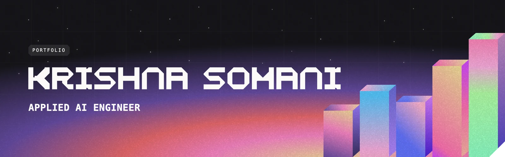
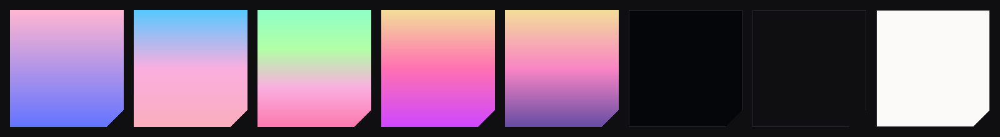

<div align="center">

## [kr7shnasomani.is-a.dev](https://kr7shnasomani.is-a.dev)

A single-page portfolio built as a small city at dusk. Gradient buildings rush past the camera as the page scrolls, the sky cools from sunset to night, and every section after that borrows the same geometry: chamfered corners, pixel lettering and gradient light.

</div>

## Design

### Colour



Five gradients carry all the colour on the site. They paint the 3D buildings, the education towers, the toolkit frames and the glows behind project and paper cards, always stepped so neighbours never share one. They live in `palettes` in `src/content.ts` as `[front, side, top]` triplets. Everything else sits on a few neutrals, defined as Tailwind tokens in `src/index.css`:

| Token | Hex | Used for |
| --- | --- | --- |
| `void` | `#05060a` | Footer, deepest panels |
| `surface` | `#0f0f12` | Page background |
| `raised` | `#16161a` | Cards, the hero stage |
| `ink` | `#fbfaf9` | Text, and the paper-white toolkit section (`paper`) |
| `ink-dim` | `#9d9db2` | Secondary text |

### Type

| Role | Face | Notes |
| --- | --- | --- |
| Display | **KS Pixel** | Drawn in code for this site (`scripts/build-font.py`): even strokes, 45° corner cuts, square counters. Uppercase only. |
| Headings | **Geist** 600 | Scaled to 94.6% so its width and x-height sit with the display face |
| Body | **Inter** 400/500 | Self-hosted through `@fontsource/inter` |
| Labels | System monospace | The `mono` utility: 11px, uppercase, 0.18em tracking |

### Shape and texture

- **Chamfered corners** (`chamfer`, cut size via `[--c:6px]`) on tags, buttons and tiles, and a large cut corner (`notch`) on cards.
- **Fine grain** (`noise`) over every gradient, from a pre-rendered tile so 3D faces don't re-rasterise a filter as they scale.
- **A faint 80px grid** (`grid-lines`) behind the hero and cards.
- **Circuit-trace frames** (`CircuitFrame` in `ui.tsx`) around each tool in the toolkit.

## Sections

In page order (`src/App.tsx`):

| Section | Component | What it does |
| --- | --- | --- |
| **Hero** | `Hero.tsx` + `City.tsx` | A CSS 3D street of gradient cuboids. Scrolling flies the camera through it while the sky fades from sunset to night, the name lands in the header and the portrait docks beside it. |
| **About** | `About.tsx` | One statement, revealed letter by letter on a scroll scrub, warming from grey to white. |
| **Education** | `Education.tsx` (rendered inside About) | A campus skyline: one extruded tower per school, rising out of a dated ground line as it scrolls into view. |
| **Experience** | `Experience.tsx` | A metro route map. On desktop the section pins while a train rides the line; each station lights its company's logo and the panel beside it switches job. Phones get a vertical list. |
| **Projects** | `Projects.tsx` | Each project's mark fills its card over a palette glow, with the name on frosted glass that opens to the description on hover. |
| **Research** | `Publications.tsx` | Journal-style cards: the venue's mark on a white masthead over a dark body lit from below. |
| **Achievements** | `Achievements.tsx` | Photo and story side by side. Organisations are named with their logo and link to their site; photos open full size in a dialog. |
| **Toolkit** | `Skills.tsx` | The one light section: filterable tool cards in circuit frames, logos in greyscale until hovered. |
| **Connect** | `Contact.tsx` | A closing skyline seen from street level, the social links, and the footer with a page map. |

Around them: `Header.tsx` (the fixed bar and section menu) and `Spine.tsx` (the scroll-progress rail on the left, desktop only).

## Motion

GSAP's ScrollTrigger drives every scroll effect, with Lenis for inertial scrolling, both on GSAP's ticker so they stay frame-locked (`src/lib/motion.ts`).

- **Compositor-only.** Motion uses `transform` and `opacity`; layout is measured once and animated with transforms.
- **Two kinds of scroll effect.** Scrubbed pieces (the hero flight, the towers, the route map) follow the scrollbar in both directions. Entrances (`revealOnScroll`) play once on arrival and rewind only after leaving the screen below, so nothing fades out while still in view.
- **Hover waits for the pointer.** Content scrolling under a resting cursor doesn't trigger hover states (the `still:` variant).
- **Reduced motion respected.** With `prefers-reduced-motion`, nothing animates and everything is visible.

## Quick start

**Requirements:** Node 22.12 or newer (CI and Vercel use 24, see `.nvmrc`) and npm. Python 3 only if you rebuild the display font.

```bash
npm install
npm run dev         # http://localhost:5173
```

| Script | What it does |
| --- | --- |
| `npm run dev` | Local dev server with hot reload |
| `npm run build` | Asset check, type check, production build into `dist/` |
| `npm run preview` | Serve the production build locally |
| `npm run check` | Everything CI runs: formatting, lint, then `build` |
| `npm run lint` | oxlint with type-aware rules |
| `npm run typecheck` | TypeScript only |
| `npm run format` / `format:check` | Apply / verify Prettier formatting |
| `npm run resume` | Copy the latest resume PDF into the site ([Resume](#resume)) |

Run `npm run check` before pushing; it's exactly what CI runs.

## How the code is organised

```
src/
  main.tsx            entry: mounts <App /> and imports index.css
  App.tsx             page order, skip link, smooth scroll
  content.ts          all data and long-form copy (see Editing content)
  index.css           Tailwind v4: @theme tokens, @utility classes, @custom-variant rules, font faces
  lib/motion.ts       GSAP + Lenis setup, EASE roles, MQ breakpoints, revealOnScroll, scroll lock, parallax
  components/
    Hero.tsx, City.tsx                     the 3D street and its camera flight
    About.tsx, Education.tsx               statement and campus skyline
    Experience.tsx                         route map (pinned on desktop, list on phones)
    Projects.tsx, Publications.tsx         cards
    Achievements.tsx                       photos, organisation chips, full-size dialog
    Skills.tsx                             toolkit grid and filters
    Contact.tsx                            Connect section and Footer
    Header.tsx, Spine.tsx                  fixed bar and menu, scroll rail
    ui.tsx                                 shared pieces: Tag, Button, Reveal, Noise, Faces, CircuitFrame
public/               static files served from the site root (images, logos, fonts, resume, _headers)
scripts/
  check-assets.mjs    fails the build when a referenced file is missing or its case differs
  build-font.py       draws and compiles the KS Pixel font
.github/
  workflows/ci.yml    the CI pipeline
  dependabot.yml      dependency update pull requests
  assets/             README images (not part of the site)
vite.config.ts        Vite plugins and the Content-Security-Policy meta tag
vercel.json           security headers on Vercel
.oxlintrc.json        lint rules
.prettierrc.json      formatting
```

Data flows one way: `content.ts` → components. Components hold layout, motion and short labels (headings, buttons); anything you'd update as your career changes lives in `content.ts`.

## Editing content

Everything below is in `src/content.ts` unless noted. After editing, run `npm run check`.

| To change | How |
| --- | --- |
| Name, email, photo, footer bio | `profile`. The hero's role line ("Applied AI Engineer") is in `Hero.tsx`. |
| About statement | `profile.tagline`. Its line breaks are hand-set per breakpoint in `About.tsx` (`toLines([...])`); **the counts must add up to the tagline's word count**, or the dev server throws an error saying so. |
| Social links | `socials`: `label`, `href`, an icon in `public/socials/`, and a brand `color` for the hover fill. LeetCode is commented out; uncomment it to show it. |
| Education | `education`, newest first. **Exactly three entries**: the skyline is drawn for three towers, and TypeScript fails the build otherwise. The intro sentence is in `Education.tsx`. |
| Experience | `experience`, newest first: `company`, `role`, `location` (`City · Country`), `period`, `logo`, `summary`, `points`. **Exactly three entries**, since the route map has three stations. |
| Projects | `projects`: `title`, `description`, `href`, `logo`. The grid is laid out for **four** projects (a large first card, a wide last card). |
| Papers | `publications`. Add `link: { href, label }` once a paper is public; leave it out to show "Publication pending". |
| Achievements | `achievements`, newest first: `title`, `highlight` (e.g. `'Winner.'`), `date`, `description`, `image`, optional `full` (uncropped image for the dialog) and `focus` (CSS `object-position` for the crop). |
| Organisations in an achievement | Write `{key}` in the description and add `key` to `orgs`: `name`, `href`, optional `logo`. A key with no entry throws an error naming it. |
| Tools | `skills`: `tool(name, file, group, href)`, where `group` is one of the `skillGroups` ids (`data`, `eng`, `ml`). Filter captions are in `skillGroups`. |
| Nav sections | `sections`: ids must match the `id` on each section element. |

## Images and assets

Files in `public/` are served from the site root: `public/orgs/atos.svg` becomes `/orgs/atos.svg`.

| Asset | Folder | Format and size |
| --- | --- | --- |
| Achievement photos | `public/image-uploads/` | WebP about 1200px on the long side, quality ~75 (the card shows ~572×440) |
| Toolkit icons | `public/image-uploads/` | SVG, or WebP at 160px |
| Organisation icons | `public/orgs/` | SVG, or WebP at 64px; shown on a white tile, so dark and light marks both work |
| Company, school, venue logos | `public/companies/`, `schools/`, `venues/` | WebP or SVG, small |
| Project marks | `public/projects/` | WebP with a transparent background |

- **Case matters.** `Logo.png` and `logo.png` are different files on Vercel and in CI. `npm run build` checks every path and fails with the file name if one doesn't match.
- **Prefer names without spaces.** Older photos have them and work, but new files should use dashes.
- **SVGs from other sites** are only ever used through `` or CSS masks, never inlined, so they can't run scripts.

## Conventions

**Code style.** Prettier (`.prettierrc.json`): no semicolons, single quotes, 200-character lines. Comments explain *why*, not *what*. TypeScript is strict; avoid `any` (lint fails on it).

**Styling.** Tailwind v4 utilities with the tokens from `index.css` (`bg-surface`, `text-ink-dim`, …). Reuse the shared utilities (`chamfer`, `notch`, `mono`, `h2`, `body-lg`, `shell`) rather than one-off values. Custom variants:

| Variant | Applies when |
| --- | --- |
| `short:` | Desktop width and under 860px tall (small laptop windows) |
| `shorter:` | Desktop width and under 700px tall |
| `still:` | The pointer has moved since the last scroll (for hover effects that shouldn't fire while scrolling) |

**Motion.** Animations follow these patterns:

- Create them inside `useGSAP(() => …, { scope })` so they clean up on unmount.
- Wrap them in `gsap.matchMedia().add(MQ.motionOk, …)`, so reduced motion gets the static page. With a condition object, include `motionOk` in it.
- Use `revealOnScroll(animation, trigger, start)` for entrances, and `scrollTrigger: { scrub }` for scroll-bound motion.
- Hide anything that contains links or buttons with `opacity`, not `autoAlpha`. `autoAlpha` sets `visibility: hidden`, which removes it from keyboard Tab order and screen readers.
- Call `ScrollTrigger.refresh()` after anything that changes page height, as the toolkit filter does.
- Scroll programmatically with `scrollToY()` and freeze scrolling with `lockScroll()` (both in `motion.ts`), because Lenis owns scrolling.

**Accessibility.** Every image has `alt` (empty for decorative ones), icon-only links get `sr-only` text, links that open a new tab say so in `sr-only` text, focus stays visible (`:focus-visible` ring), and the reduced-motion page must stay fully readable. `Button` in `ui.tsx` adds `target="_blank" rel="noopener noreferrer"` to external and `.pdf` links automatically.

**Dependencies.** Keep them few. At runtime it's React, GSAP, Lenis and the Inter font, nothing else.

## Security

The built site sends a strict Content-Security-Policy: scripts, styles, fonts and images may only come from the site itself (plus the `data:` images the 3D city generates). It's defined in **three places that must stay in sync**:

1. `vite.config.ts`: a `<meta>` tag injected into the production build
2. `vercel.json`: HTTP headers on Vercel (also `X-Frame-Options`, `nosniff`, `Referrer-Policy`, `Permissions-Policy`)
3. `public/_headers`: the same headers for Netlify or Cloudflare Pages

Adding anything external (an analytics script, a font CDN, an embed, an API call) means updating the policy in all three, or the browser will block it. There's no `dangerouslySetInnerHTML` anywhere; keep it that way.

### Supply chain

Compromised npm packages usually attack through install scripts or by shipping a malicious version that gets installed within hours of release. This repo is set up so neither reaches your machine or CI:

| Guard | Where | Effect |
| --- | --- | --- |
| No install scripts | `.npmrc` `ignore-scripts=true`, `strict-allow-scripts=true` | Dependencies can't run code during install. None of the 54 packages need to; if one ever ships a script, the install fails loudly. |
| 7-day minimum age | `.npmrc` `min-release-age=7` | npm refuses any version published less than a week ago, by which time hijacked releases are usually caught and pulled. |
| Exact versions | `package.json` (no `^` ranges), `package-lock.json`, `save-exact=true` | Versions only change through a reviewed pull request. |
| Lockfile installs only | `npm ci` locally, in CI and on Vercel (`installCommand`) | Every install gets exactly the committed versions. |
| Signature check | CI step `npm audit signatures` | Every package must carry a valid npm registry signature. |
| Update cooldown | `.github/dependabot.yml` `cooldown` | Dependabot waits 7 days (14 for major versions) before proposing an update. |
| Pinned CI actions | `.github/workflows/ci.yml` | Actions are pinned to commit hashes, so a moved tag can't swap in other code; the checkout doesn't keep the GitHub token. |

Working rules:

- Install with `npm ci`. Add a package with `npm install <name>`: `.npmrc` still applies, so it is pinned, script-free and at least a week old.
- Never pass `--ignore-scripts=false`, `--dangerously-allow-all-scripts` or `--min-release-age=0` to get around an error. Find out why first.
- Keep the dependency list short. Every package is code that runs on your machine.

## CI/CD

There are three automated pieces, and only one of them is a pipeline file:

| Piece | Where | What it does | When |
| --- | --- | --- | --- |
| **CI** | `.github/workflows/ci.yml` (GitHub Actions) | One job: install, then four checks (Prettier, type-aware lint, build with its asset and type checks, dependency audit). Any failure marks the commit or pull request red | Every push to `main` and every pull request |
| **CD** | Vercel's GitHub integration (configured in Vercel, not in this repo) | Builds and deploys: a preview URL for each pull request, production from `main` | Every push |
| **Dependency updates** | `.github/dependabot.yml` | Opens grouped weekly pull requests for npm packages and GitHub Actions, which then go through CI | Weekly |

To make CI a real gate, enable branch protection on `main` in GitHub (Settings → Branches) and require the **Format, lint, type check and build** check.

## Deploying

1. Push to GitHub.
2. In Vercel, **Add New → Project** and import the repo. It detects Vite: build command `npm run build`, output directory `dist`. No environment variables are needed.
3. **Settings → Domains**: add the custom domain and set the DNS records Vercel shows.

`vercel.json` applies the security headers automatically. Every later push to `main` redeploys.

## Resume

The resume is served from this repo at `/Krishna-Somani-Resume.pdf`, so the link never changes. To update it, export the new PDF to `~/Documents/Resume/Krishna-Resume.pdf`, then:

```bash
npm run resume
git add public/Krishna-Somani-Resume.pdf && git commit -m "Update resume" && git push
```

Vercel redeploys on push. On another machine, just replace `public/Krishna-Somani-Resume.pdf` and keep the name.

## Display font

KS Pixel is generated, not drawn by hand: every glyph is built from rectangles and 45° strokes in `scripts/build-font.py` and compiled to `public/fonts/ks-pixel.woff2`.

```bash
pip install fonttools brotli shapely
python3 scripts/build-font.py
```

It covers A–Z (lowercase maps to the capitals), 0–9 and `. , : ; ! ' ? - – · % × & $ /`. Any other character in a display heading falls back to the monospace font, so add a glyph before using it.

## Gotchas

- **ESLint isn't used, on purpose.** typescript-eslint doesn't support TypeScript 7 yet; oxlint runs the same rule sets (`.oxlintrc.json`) and does.
- **Use the app's scroll helpers.** Lenis owns scrolling, so don't call `window.scrollTo` for smooth scrolls; use `scrollToY`. In-page `#links` are handled for you, and they also move keyboard focus.
- **Changing page height** (adding, removing or filtering content) needs `ScrollTrigger.refresh()`, or triggers further down fire in the wrong place.
- **Hero and pinned sections use `svh` units**, so mobile browser bars don't make them jump.
- **After rebuilding KS Pixel,** hard-reload; browsers cache the font.
